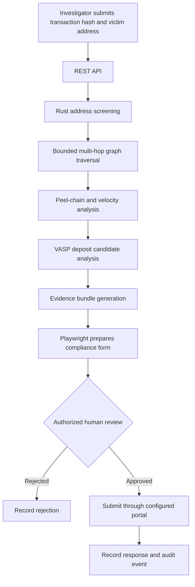

# SPECTER — See Beyond Blockchain

> **Autonomous On-Chain Incident Response & Human-in-the-Loop Asset Freeze Engine**  
> Bridging blockchain transaction forensics with centralized exchange compliance workflows.

SPECTER is an incident-response platform designed to trace potentially stolen cryptocurrency across multi-hop transaction paths, assemble verifiable evidence, prepare exchange compliance submissions, and keep an authorized human investigator in control of the final submission.

> [!IMPORTANT]
> **Project status:** This README describes the intended architecture and behavior in the project specification. It does not establish that every component, benchmark, or live exchange integration has been implemented or independently validated. The local compliance portal is a mock portal. Performance figures are targets or illustrative values until reproduced in documented tests.

## Table of Contents

- [Why SPECTER?](#why-specter)
- [Core Workflow](#core-workflow)
- [Key Features](#key-features)
- [System Architecture](#system-architecture)
- [Technology Stack](#technology-stack)
- [Project Structure](#project-structure)
- [Prerequisites](#prerequisites)
- [Getting Started](#getting-started)
- [API Reference](#api-reference)
- [MCP Tools](#mcp-tools)
- [Evidence and Attribution](#evidence-and-attribution)
- [Security and Authorization](#security-and-authorization)
- [Performance and Validation](#performance-and-validation)
- [Limitations](#limitations)
- [Roadmap](#roadmap)
- [Contributing](#contributing)
- [License](#license)

## Why SPECTER?

Cryptocurrency fraud investigations can involve complex transaction paths, intermediary wallets, and time-sensitive requests to virtual asset service providers (VASPs). Manual tracing and compliance paperwork can slow down the response.

SPECTER aims to reduce that operational overhead by connecting four stages:

1. **Trace** — Follow relevant on-chain transfers through a bounded transaction graph.
2. **Analyze** — Identify patterns that may indicate peel chains, fan-out behavior, or exchange deposit activity.
3. **Document** — Package transaction lineage, hashes, and case information into an evidence bundle.
4. **Prepare for review** — Populate a compliance intake workflow and pause for explicit authorization before submission.

SPECTER supports investigation and evidence preparation. It does not independently determine guilt, prove beneficial ownership of a wallet, or guarantee that an exchange will freeze assets.

## Core Workflow



### Investigation Lifecycle

1. An investigator submits a suspicious transaction hash, victim wallet, and blockchain.
2. The Rust core screens relevant addresses against configured risk lists.
3. The graph engine traverses a configurable number of hops and records candidate transaction paths.
4. Heuristics analyze peel-chain patterns and potential VASP deposit endpoints.
5. The evidence module packages observed transaction data and lineage.
6. The browser agent prepares a compliance intake form.
7. An authorized investigator reviews the evidence and approves or rejects the submission.
8. The system records the outcome and any receipt returned by the portal.

Graph and attribution outputs are investigative leads, not proof of identity or ownership.

## Key Features

### 1. High-Speed Address Screening

The proposed Rust screening layer uses in-memory data structures, including a Bloom filter and binary-searchable registry data, to check addresses against configured sanctions, mixer, and known-drainer lists.

The specification targets screening latency below **100 microseconds**. This is a target, not a verified guarantee. Actual performance depends on the dataset, hardware, implementation, and benchmark methodology.

### 2. Multi-Hop Transaction Tracing

The graph engine is designed to:

- Perform bounded breadth-first search (BFS).
- Traverse configurable transaction depths.
- Apply volume-decay and forwarding-ratio heuristics.
- Identify candidate peel-chain and fan-out patterns.
- Analyze transaction timing and transfer velocity.
- Trace candidate paths toward potential exchange deposit addresses.

A forwarding-ratio threshold such as `0.85` is a heuristic, not a universal indicator of laundering. Transaction fees, change outputs, bridges, batching, and ordinary exchange activity can produce similar patterns.

### 3. VASP Deposit Analysis

SPECTER proposes a weighted heuristic based on:

- Omnibus-wallet sweep patterns.
- Transaction interaction patterns.
- Gas-funder relationships and funding signatures.

These signals can help prioritize potential exchange deposit addresses. They cannot independently establish customer identity or prove that an exchange controls an address.

Attribution results should include confidence, supporting evidence, and alternative explanations.

### 4. Cryptographic Evidence Bundling

The evidence module is designed to package transaction lineage using BLAKE3 hashes and a Merkle-tree root.

An evidence bundle may contain:

- Transaction hashes and block references.
- Transfer amounts and timestamps.
- The traced transaction path.
- Data provenance and collection timestamps.
- Cryptographic hashes and Merkle-root information.
- Case identifiers and analytical findings.

**A Merkle root alone does not prove that source data is true or that evidence is legally admissible.** Preserve source records, collection timestamps, network identifiers, and data-provider information.

### 5. Automated Compliance Form Preparation

A Playwright-based browser agent is designed to open a visible Chromium session and populate fields in a configured compliance intake portal.

The supplied local setup uses a mock portal. Real exchange portals vary, and this project does not claim a universal integration with Binance, Bybit, OKX, or any other exchange.

### 6. Human-in-the-Loop Authorization

The intended workflow pauses before final submission so an authorized investigator can review the case.

A production deployment must enforce authorization on the server, including identity verification, role permissions, case access, approval scope, and valid signature verification. A browser confirmation alone is not a sufficient security boundary.

## System Architecture

```text
┌──────────────────────────────────────────────────────────┐
│             INVESTIGATOR / CASE INTAKE UI                │
│       Transaction Hash · Victim Address · Chain          │
└───────────────────────────┬──────────────────────────────┘
                            │ HTTP
                            ▼
┌──────────────────────────────────────────────────────────┐
│                  SPECTER RUST CORE                       │
│                                                          │
│  ┌────────────────────────────────────────────────────┐  │
│  │ Address Screening                                  │  │
│  │ Risk Registries · In-Memory Lookup                 │  │
│  └────────────────────────┬───────────────────────────┘  │
│                           ▼                              │
│  ┌────────────────────────────────────────────────────┐  │
│  │ Graph & Typology Analysis                          │  │
│  │ BFS · Volume Ratios · Velocity · VASP Candidates   │  │
│  └────────────────────────┬───────────────────────────┘  │
│                           ▼                              │
│  ┌────────────────────────────────────────────────────┐  │
│  │ Cryptographic Evidence Compiler                    │  │
│  │ Transaction Lineage · BLAKE3 · Merkle Root         │  │
│  └────────────────────────────────────────────────────┘  │
└───────────────────────────┬──────────────────────────────┘
                            │ JSON over HTTP
                            ▼
┌──────────────────────────────────────────────────────────┐
│              PLAYWRIGHT BROWSER AGENT                    │
│       Visible Browser · Compliance Form Preparation      │
└───────────────────────────┬──────────────────────────────┘
                            ▼
┌──────────────────────────────────────────────────────────┐
│               HUMAN AUTHORIZATION                        │
│        Evidence Review · Approval · Rejection            │
└───────────────────────────┬──────────────────────────────┘
                            ▼
┌──────────────────────────────────────────────────────────┐
│             SUBMISSION RESULT & AUDIT LOG                │
│         Portal Response · Receipt · Case Events          │
└──────────────────────────────────────────────────────────┘

External integration:
MCP server exposes forensic capabilities to compatible clients.
```

### Core Components

| Component | Responsibility |
|---|---|
| `specter-core` | Address screening, chain handling, graph traversal, typology analysis, evidence generation, and ledger access. |
| `specter-server` | Axum REST API, request routing, case state, and service telemetry. |
| `specter-mcp` | MCP server exposing forensic operations to compatible clients. |
| `specter-agent` | Playwright browser automation and the local mock compliance portal. |

## Technology Stack

- **Core engine:** Rust
- **HTTP API:** Axum
- **Async runtime:** Tokio
- **Browser automation:** Node.js, Playwright, Chromium
- **Agent interoperability:** Model Context Protocol (MCP), JSON-RPC 2.0
- **Evidence hashing:** BLAKE3
- **Blockchain connectivity:** Public ledger data sources for TRON, EVM-compatible networks, and Bitcoin, subject to implementation support
- **Testing:** Rust unit tests, integration tests, and benchmarks

Exact dependency versions, RPC providers, configuration keys, and supported networks should be documented alongside the implementation.

## Project Structure

The following structure reflects the supplied project specification. Actual files may differ depending on implementation progress.

```text
specter/
├── Cargo.toml
├── crates/
│   ├── specter-core/
│   │   ├── src/
│   │   │   ├── system1.rs
│   │   │   ├── graph.rs
│   │   │   ├── vasp.rs
│   │   │   ├── proof.rs
│   │   │   ├── typologies.rs
│   │   │   ├── velocity.rs
│   │   │   ├── sahyog.rs
│   │   │   ├── chain.rs
│   │   │   └── live_client.rs
│   │   └── tests/
│   │       └── benchmarks.rs
│   ├── specter-server/
│   │   ├── src/
│   │   │   ├── main.rs
│   │   │   ├── routes.rs
│   │   │   └── state.rs
│   │   └── tests/
│   │       └── api_tests.rs
│   ├── specter-mcp/
│   │   └── src/
│   │       └── main.rs
│   └── specter-agent/
│       ├── browser_actor.js
│       ├── portal_server.js
│       └── package.json
└── README.md
```

## Prerequisites

The supplied specification lists:

- Rust stable toolchain, version 1.75 or later.
- Node.js version 18 or later.
- npm.
- Chromium dependencies required by Playwright on your operating system.

The actual minimum supported versions are determined by the repository's manifests and lockfiles.

## Getting Started

> These commands follow the supplied workspace specification. They assume the files and Cargo package names exist as shown. Adjust them if your implementation differs.

### 1. Clone the Repository

Replace the placeholder URL with your actual repository URL.

```bash
git clone https://github.com/<your-username>/specter.git
cd specter
```

### 2. Build and Test the Rust Workspace

```bash
cargo test --workspace
```

Run the screening benchmark tests, if implemented:

```bash
cargo test -p specter-core --test benchmarks
```

The benchmark command depends on the test target declared in `crates/specter-core/Cargo.toml`.

### 3. Start the Rust API Server

In one terminal:

```bash
cargo run -p specter-server
```

The supplied specification expects the server at:

`http://localhost:8080`

Check the health endpoint:

```http
GET http://localhost:8080/api/v1/health
```

### 4. Install Browser-Agent Dependencies

In another terminal:

```bash
cd crates/specter-agent
npm install
npx playwright install chromium
```

### 5. Start the Mock Compliance Portal

Start the mock portal:

```bash
node portal_server.js
```

In a separate terminal, start the browser agent:

```bash
cd crates/specter-agent
node browser_actor.js
```

The supplied specification describes the mock portal on port `3000` and the browser-agent bridge on port `3001`. Confirm the actual ports and required environment variables in the implementation.

**Local-development safety:** Bind development services to localhost, use synthetic case data, and never expose the mock portal or browser bridge to a public network.

## API Reference

The following examples reflect the API contract described in the project specification. They are illustrative; verify request validation, response schemas, and authentication against the actual implementation.

### Health Check

`GET /api/v1/health`

Illustrative response:

```json
{
  "status": "ONLINE",
  "engine": "SPECTER-Rust-Core",
  "system1_latency_p99_us": 48,
  "mcp_server_status": "READY",
  "active_browser_drivers": 1
}
```

The latency value is an example from the specification, not a guaranteed result.

### Run a Forensic Trace

`POST /api/v1/trace`

Content-Type: `application/json`

```json
{
  "stolen_tx_hash": "0x4a8b7c3d2e1f0a9b8c7d6e5f4a3b2c1d0e9f8a7b6c5d4e3f2a1b0c9d8e7f6a5b",
  "victim_wallet": "0x71c6bfb575a35b50e76ec92432dd2741b23ac3a9",
  "chain": "ethereum",
  "max_hops": 4
}
```

The transaction hash and wallet above are sample values. Replace them with valid data for the selected network.

The API should validate address format, transaction existence, network compatibility, and permitted hop limits.

### Prepare a Freeze-Request Form

`POST /api/v1/agent/prepare-freeze`

```json
{
  "case_id": "SPECTER-2026-9921",
  "target_vasp": "ExampleExchange",
  "deposit_address": "0x3f5ce5fb59e02f43cf8d1326be81a329d448181a"
}
```

This operation should prepare the configured intake form for review. It must not submit a request or freeze assets by itself.

### Authorize and Submit

`POST /api/v1/agent/sign-and-submit`

```json
{
  "case_id": "SPECTER-2026-9921",
  "officer_badge_id": "INV-LE-4092",
  "signature_token": "<real-validated-signature-or-token>",
  "approved": true
}
```

The signature value is a placeholder, not a usable credential. The server must validate identity, authorization, signature, case scope, and approval before permitting submission.

A request body containing `"approved": true` must never be sufficient by itself to authorize a real action.

### API Security Requirements

Before exposing these endpoints beyond a local prototype, implement:

- Authentication and role-based authorization.
- Schema validation and strict hop/depth limits.
- Rate limiting, request-size limits, and timeouts.
- Case-level access control and replay protection.
- Idempotency for submission requests.
- Redaction of secrets and sensitive data from logs.
- Explicit case states for prepared, reviewed, approved, submitted, rejected, and failed.
- Durable audit records and safe handling of portal receipts.

## MCP Tools

The specification describes these MCP tools:

| Tool | Purpose |
|---|---|
| `specter_screen_address` | Screen an address against configured risk registries. |
| `specter_trace_hops` | Traverse a transaction graph and return candidate paths. |
| `specter_generate_evidence_bundle` | Package transaction lineage and cryptographic hashes. |
| `specter_analyze_typologies_and_velocity` | Analyze transaction patterns and temporal activity. |
| `specter_generate_sahyog_package` | Prepare a statutory-notice package for human review. |
| `specter_dispatch_voice_alert` | Generate incident audio alerts or voice telemetry. |

Tool schemas, input constraints, output formats, error codes, and authorization behavior should be documented in the MCP server implementation.

MCP tool calls must not bypass the access-control and approval rules enforced by the REST API.

## Evidence and Attribution

SPECTER should distinguish observed facts from analytical conclusions.

A useful evidence bundle should preserve:

- Chain/network identifier and data source.
- Transaction hash, block number, timestamp, and transfer details.
- Exact traversal path and the rule that selected it.
- Raw observations separately from derived heuristics.
- Registry name, version, and lookup timestamp.
- Attribution signals, confidence, and plausible alternative explanations.
- Evidence-bundle version, hash algorithm, Merkle root, and verification instructions.
- Collection time, operator, and audit history.

Do not label a wallet as criminal or exchange-controlled solely because it matches a heuristic. Legal admissibility depends on applicable law, collection procedures, provenance, authenticity, and the relevant authority's assessment.

## Security and Authorization

The design calls for the following safeguards:

1. **No unilateral submission:** The browser agent pauses for authorized review before a formal request is submitted.
2. **Evidence integrity:** Hashes and a Merkle root make post-collection changes detectable when verification data is retained.
3. **Attribution guardrails:** Token contracts and infrastructure addresses must not be treated as exchange deposit accounts merely because they appear in a transaction path.
4. **Least privilege:** Separate forensic analysis, review, approval, and submission permissions.
5. **Auditability:** Record who approved each action, what evidence they reviewed, and what the portal returned.
6. **Secrets protection:** Never commit API keys, signing keys, or portal credentials.
7. **Safe automation:** Restrict browser automation to explicitly configured domains and test portals. Require renewed review if the form contents or target changes.

### Legal Terminology

The original specification references Section 91 CrPC and Section 94 BNSS. Applicable provisions depend on jurisdiction, date, requesting authority, and the nature of the request.

Have qualified counsel or the relevant legal authority validate statutory references and templates before operational use. SPECTER is a technical tool, not legal advice.

## Performance and Validation

The specification includes a target of **less than 100 µs** for the in-memory screening stage and an illustrative health response reporting **48 µs p99** latency. These figures must not be presented as verified project results unless reproduced by tests.

For meaningful validation, measure and publish:

- Screening p50, p95, and p99 latency at documented dataset sizes.
- Cold-start and warm-cache behavior.
- Graph traversal time and visited-node/edge counts.
- RPC latency, provider limits, and retry behavior.
- Evidence-generation time and verification results.
- Browser form-preparation and submission outcomes against the mock portal.
- False-positive and false-negative rates for evaluated detection rules.
- Memory use, throughput, and behavior under malformed or adversarial inputs.

Use synthetic or appropriately anonymized data in tests. A microbenchmark of an in-memory lookup does not represent end-to-end incident-response latency.

## Limitations

- **Heuristic attribution:** On-chain patterns rarely prove real-world ownership by themselves.
- **Chain coverage:** Supported networks and asset types depend on implemented adapters and available data providers.
- **Provider dependencies:** Public RPC endpoints can rate-limit, lag, or return incomplete data.
- **Exchange workflow variability:** Compliance portals are provider-specific and may require additional documentation or manual contact.
- **No guaranteed freeze:** Preparing or submitting a request does not guarantee acceptance, account restrictions, or asset recovery.
- **Legal review required:** Jurisdiction-specific notice templates must be validated before use.
- **Prototype boundaries:** The mock portal demonstrates a local workflow; it is not a live exchange integration.

## Roadmap

Potential next steps, subject to actual implementation status:

- [ ] Publish reproducible screening and graph benchmarks.
- [ ] Add versioned configuration for risk registries and RPC providers.
- [ ] Define stable API schemas and machine-readable error responses.
- [ ] Add durable case storage and an append-only audit trail.
- [ ] Implement cryptographic signature verification and role-based approval.
- [ ] Add evidence-bundle export and independent verification tooling.
- [ ] Test attribution heuristics against labeled datasets and document error rates.
- [ ] Add integration tests for browser automation against the mock portal.
- [ ] Document supported chains, tokens, providers, and known gaps.
- [ ] Validate statutory templates with qualified legal reviewers.

## Contributing

Contributions are welcome.

Before submitting a change:

1. Open an issue describing the problem or proposed improvement.
2. Keep forensic observations separate from inferred attribution.
3. Add tests for new parsing, tracing, authorization, and evidence logic.
4. Include benchmark methodology when making performance claims.
5. Never include real victim data, private keys, credentials, or unredacted case material in tests or issues.
6. Update this README when API contracts, supported chains, configuration, or security behavior changes.

## License

The supplied specification names **Apache-2.0** and credits **SPECTER Core Architecture Group (2026)**.

Add the corresponding `LICENSE` file and confirm the project's actual copyright holder before distributing the repository under that license.
